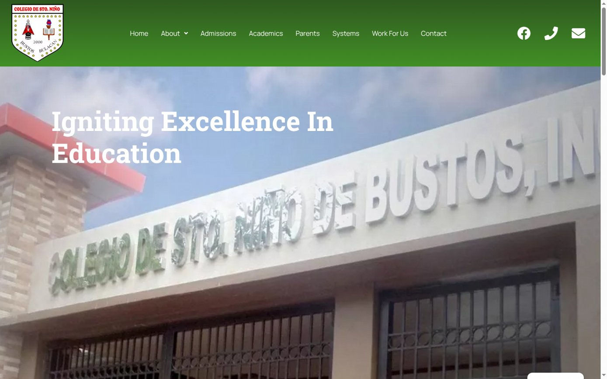
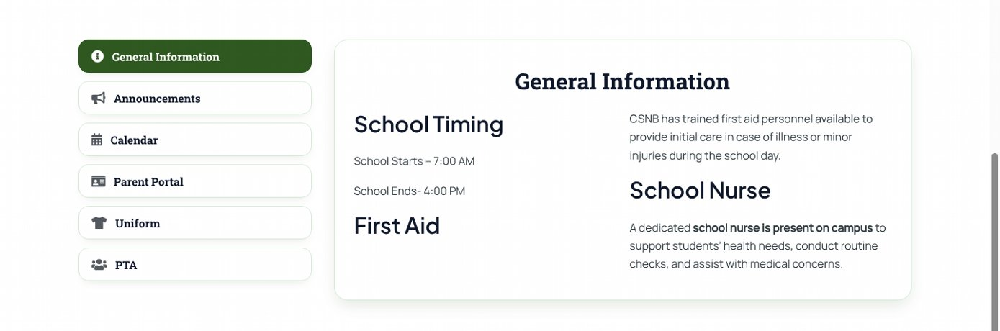
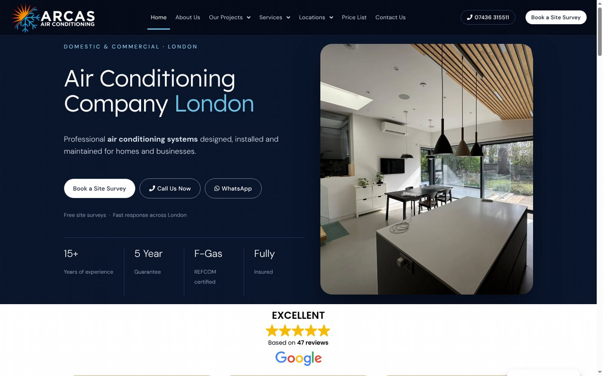
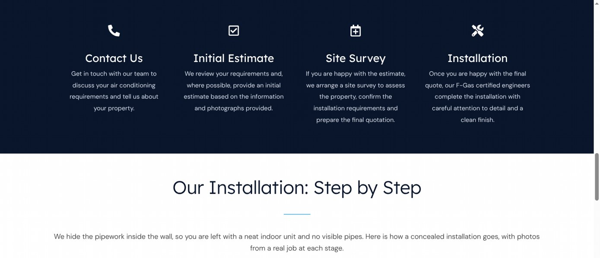

# Web Development Portfolio

Websites and tools I build and maintain for real clients, alongside my BSc Computer Science at the University of Reading.

**Benjamin Vicente** · Web Developer & IT Support (part-time, remote) · Jun 2026 – present

---

## Colegio de Sto. Niño de Bustos (CSNB)

**Live site:** [csnb.org](https://csnb.org) · WordPress

The public website for a Catholic school in Bustos, Bulacan, Philippines. It is the school's main online channel for parents, students, staff and new families.

**What I did**
- Designed, built and maintain the site, structured around what each audience needs: **About, Admissions, Academics, Parents, Systems, Work For Us** and **Contact**.
- Built a **Parents hub** with tabbed sections for general information, announcements, the school calendar, the parent portal, uniform and the PTA, so parents can find everything on one page.
- Added quick links on the homepage to the most-used tasks: enrolment requirements, the parent portal, announcements, the calendar and the school charity.
- Set up a **cookie consent banner, privacy policy and cookie policy**, so third-party content like maps and videos only loads after consent.
- Keep the site up to date as the school's needs change, including the new PTA section.

---

## Arcas Air Conditioning

**Live site:** [arcasairconditioning.com](https://arcasairconditioning.com) · WordPress

The website for a family-run air conditioning installer serving homes and businesses across London. Its job is to turn visitors into enquiries and booked site surveys.

**What I did**
- Designed and built the company's WordPress website, with every page leading to one action: **Book a Site Survey**, backed up by click-to-call and **WhatsApp** buttons.
- Built trust into the homepage with a **live Google reviews feed**, the company's certifications and guarantees, and the manufacturer brands they install.
- Created pages for **services** (installation, maintenance, emergency repair), **London locations** (North, South, East and West) and a **price list**, which help with local search as well as answering customer questions.
- Turned a real job into a **step-by-step installation gallery**, so customers can see the process and the finish before they book.
- Added an **FAQ section**, a blog, a cookie consent banner, and privacy, cookie, terms and company policy pages.
- Built **custom Excel client trackers** so the team can manage customers, jobs and follow-ups in one place.
- Act as the business's go-to technical support for day-to-day IT, software and website problems.

<!-- Optional: a screenshot of a client tracker filled with made-up data (never real customer details) -->
<!--  -->

---

## Skills used

WordPress · responsive design · site structure and content planning · hosting and domains · cookie consent and privacy setup · Excel · client communication · IT support

## Contact

[LinkedIn](https://www.linkedin.com/in/benjamin-vicente-586290320/) · [GitHub](https://github.com/BenzaVic) · benjamin.vicente200@gmail.com
